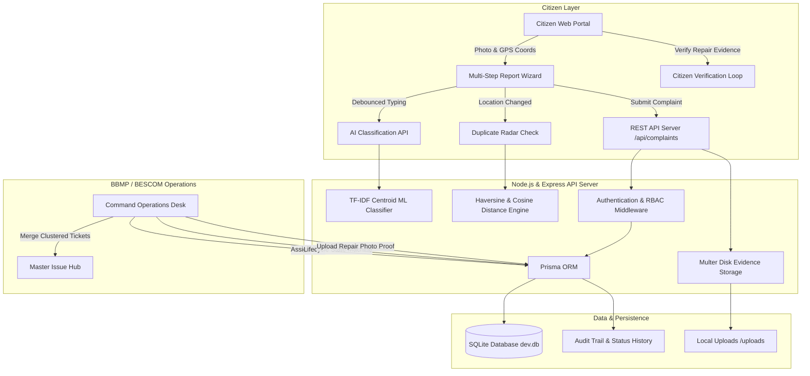

# CITYSAATHI — An AI-Powered Civic Complaint Management and Resolution Verification System

> **“Your City. Your Voice. Your Saathi.”**  
> *Report. Track. Resolve. Verify. Together.*

[](https://nodejs.org)
[](https://expressjs.com)
[](https://prisma.io)
[](https://sqlite.org)
[](https://ai.google.dev/)
[](https://leafletjs.com/)
[-10B981)](#-automated-testing--qa)
[](#-ai--machine-learning-architecture)

---

## 🏛️ Project Abstract

**CitySaathi** is a full-stack civic-tech enterprise and smart-city governance platform engineered for municipal administrations (such as Bengaluru's BBMP, BESCOM, BWSSB, and Solid Waste Management) and urban citizens.

Traditional municipal helplines suffer from four critical architectural failures:
1. **Misclassification & routing latency:** Complaints bounce between unrelated departments due to manual sorting.
2. **Duplicate report deluge:** Multiple residents report the exact same defect (e.g. an arterial road crater), creating redundant work orders and fragmented dispatching.
3. **Black-box priority heuristics:** Citizens have no visibility into how urgent their report is rated or why.
4. **False closure / "Ghost resolutions":** Authorities mark tickets "Resolved" without verifiable proof or citizen sign-off.

**CitySaathi solves these systemic issues through an integrated, closed-loop civic intelligence architecture:**
- **Supervised TF-IDF Vector Space Classifier:** Classifies unstructured multi-lingual complaints into municipal agencies with 84.0% accuracy and confidence scoring.
- **Explainable Multi-Factor Priority Engine:** Dynamically weights safety hazards, transit corridors, and corroboration volume with transparent reasoning.
- **Proactive Geolocation & Text Duplicate Radar:** Evaluates Haversine spatial proximity ($< 600\text{m}$) and cosine text similarity to detect duplicates before submission.
- **Master Ticket Consolidation Hub:** Enables municipal supervisors to merge clustered duplicate reports into unified master issues while notifying all citizen subscribers.
- **Closed-Loop Citizen Verification System:** Mandates photographic repair proof and citizen confirmation (*"Yes, it's fixed"* vs *"No, still needs attention"*), awarding Saathi Karma points and auto-reopening unresolved work.

---

## 🏗️ System Architecture



---

## 🌟 Core Innovations & Capabilities

### 1. 🤖 AI Complaint Classification & Triage
- **Supervised Machine Learning:** TF-IDF Vector Space & Centroid Cosine Distance classifier trained on 125 stratified Bengaluru civic incident reports across 5 categories:
  - `Road / Pothole` (BBMP Road Infrastructure)
  - `Garbage / Waste` (Solid Waste Management Cell)
  - `Streetlight` (BESCOM Electrical Cell)
  - `Water / Drainage` (BWSSB Water & Sewerage)
  - `Public Amenities` (Parks & Traffic Engineering)
- **Calibrated Probabilities & Anchor Boosting:** Domain-specific civic anchors (`crater`, `manhole`, `pipeline`, `wire`, `bescom`, `dump`) boost class confidence.
- **Low-Confidence Fallback Guard:** If highest class probability is under $0.35$, marks report for human supervisor desk review with guidance.
- **Model Evaluation Metrics Endpoint (`GET /api/ai/metrics`):** Generates live test-split confusion matrices, precision, recall, and F1 scores suitable for academic defense panels.

### 2. ⚡ Explainable Multi-Factor Priority Engine
Priority is computed using transparent, rule-backed scoring ($0 - 100$):
- **Critical Safety Hazards (+45 pts):** Triggers on dangerous hazards (`live wire`, `open manhole`, `deep crater`, `cave-in`, `burst pipeline`, `gas leak`).
- **High Severity Disturbance (+25 pts):** Triggers on public disturbance (`flooding`, `stagnant pool`, `commercial dump`, `complete darkness`).
- **Transit Density Multiplier (+15 pts):** Detects major arterial corridors (`100ft road`, `ring road`, `metro pillar`, `junction`, `signal`).
- **Corroboration Multiplier (+10 pts):** Multiple citizen reports in the same cluster increase dispatch urgency.
- **Dynamic SLA Allocation:**
  - `Critical`: 24-hour turnaround
  - `High`: 48-hour turnaround
  - `Medium`: 72-hour turnaround
  - `Low`: 5-day routine maintenance

### 3. 🎯 Proactive Spatial & Textual Duplicate Radar
- Combines **Haversine Geolocation Distance** ($\le 600\text{m}$) and **TF-IDF bigram text cosine similarity**.
- Prevents false duplicates from generic terms (`issue`, `problem`, `bengaluru`, `please`).
- Warns citizens before final submission with distance, similarity percentage, and match justification.
- Citizen can choose to upvote existing ticket or proceed with unique circumstance.

### 4. 🔄 Closed-Loop Citizen Verification System
- Tickets cannot simply vanish into an unverified "Closed" state.
- Upon repair, field officers upload photographic proof to `/uploads`.
- Status transitions to `Resolved`.
- The reporting citizen receives an alert with side-by-side **BEFORE vs AFTER** photo comparison.
- Two explicit citizen actions:
  - **✓ "Yes, it's fixed!"**: Transitions status to `Verified`, locks work order, and awards **+50 Saathi Karma Points** to the citizen.
  - **✗ "No, still needs attention"**: Transitions status to `Reopened`, records feedback, and flags ticket on supervisor queue for rework.

### 5. 🏛️ Municipal Operations Command Center
- Role-Based Access Control (`requireRole('AUTHORITY')`).
- Strict lifecycle state-machine enforcement:
  $$\text{Submitted} \longrightarrow \text{Assigned} \longrightarrow \text{In Progress} \longrightarrow \text{Resolved} \longrightarrow \text{Verified} \ (\text{or Reopened})$$
- Departmental assignment & field staff allocation dropdowns.
- **Duplicate Consolidation Hub:** Merges secondary duplicate reports under a `MasterIssue` with automated audit logging.

### 6. 📊 Real-Time Analytics & Ward Health Index
- Dynamic Canvas charts (zero external CDN script dependencies).
- Calculated Ward Civic Health Score ($40 - 98$ scale) evaluating resolution efficiency across Indiranagar, Koramangala, Whitefield, HSR Layout, MG Road, and Jayanagar.
- 7-day municipal velocity trend (reported vs resolved per day).

---

## 🗄️ Relational Database Schema (`Prisma`)

```prisma
model User {
  id           Int       @id @default(autoincrement())
  email        String    @unique
  passwordHash String
  name         String
  role         String    @default("CITIZEN") // CITIZEN, AUTHORITY
  ward         String?
  phone        String?
  karmaPoints  Int       @default(0)
  createdAt    DateTime  @default(now())
}

model Department {
  id         Int       @id @default(autoincrement())
  name       String    @unique
  code       String    @unique
  category   String
  staff      Staff[]
  complaints Complaint[]
}

model Staff {
  id           Int        @id @default(autoincrement())
  name         String
  email        String     @unique
  roleTitle    String
  departmentId Int
  department   Department @relation(fields: [departmentId], references: [id])
}

model Complaint {
  id              Int         @id @default(autoincrement())
  complaintCode   String      @unique // CS-2026-00084
  title           String
  description     String
  category        String
  priority        String      @default("Medium")
  status          String      @default("Submitted")
  ward            String?
  locationAddress String
  latitude        Float?
  longitude       Float?
  beforePhotoUrl  String?
  afterPhotoUrl   String?
  resolutionNotes String?
  citizenId       Int
  departmentId    Int?
  assignedStaffId Int?
  masterIssueId   Int?
  isDuplicate     Boolean     @default(false)
  duplicateOfId   Int?
  statusHistory   ComplaintStatusHistory[]
  verifications   CitizenVerification[]
  notifications   Notification[]
}

model CitizenVerification {
  id          Int       @id @default(autoincrement())
  complaintId Int
  citizenId   Int
  isFixed     Boolean
  feedback    String?
  createdAt   DateTime  @default(now())
}
```

---

## 🌐 REST API Endpoints

| Category | Method | Endpoint | Access | Purpose |
| :--- | :--- | :--- | :--- | :--- |
| **System** | `GET` | `/api/health` | Public | System uptime, DB connection, & entity count |
| **Auth** | `POST` | `/api/auth/register` | Public | Register citizen account with BCrypt hashing |
| **Auth** | `POST` | `/api/auth/login` | Public | Sign in and receive Bearer JWT token |
| **Auth** | `POST` | `/api/auth/demo-login` | Public | 1-click presentation login (`citizen` or `authority`) |
| **Auth** | `GET` | `/api/auth/profile` | Auth | Authenticated user profile and Karma statistics |
| **AI** | `POST` | `/api/ai/classify` | Public | Real-time TF-IDF categorization & priority score |
| **AI** | `POST` | `/api/ai/gemini-assist`| Public | Google Gemini 2.5 structured assistant & suggestions |
| **AI** | `POST` | `/api/ai/gemini-rewrite`| Public | Google Gemini 2.5 complaint clarifier & rewrite |
| **AI** | `GET` | `/api/ai/metrics` | Public | Stratified test evaluation (Precision, Recall, F1) |
| **Duplicates** | `POST` | `/api/duplicates/check`| Public | Haversine + Cosine duplicate candidate scan |
| **Duplicates** | `POST` | `/api/duplicates/merge`| Authority| Consolidate duplicates under a Master Issue |
| **Complaints** | `GET` | `/api/complaints` | Public | Filterable list (ward, category, status, priority) |
| **Complaints** | `GET` | `/api/complaints/:id` | Public | Complaint details, timeline history, & verifications |
| **Complaints** | `POST` | `/api/complaints` | Auth | Create complaint with Multer photo upload |
| **Complaints** | `PATCH` | `/api/complaints/:id/status`| Authority| Transition status through valid state machine |
| **Complaints** | `PATCH` | `/api/complaints/:id/assign`| Authority| Allocate department & field engineer |
| **Complaints** | `POST` | `/api/complaints/:id/evidence`| Authority| Upload repair proof photo & resolution notes |
| **Complaints** | `POST` | `/api/complaints/:id/verify`| Auth | Citizen verification loop (*"Fixed"* vs *"Reopened"*) |
| **Map** | `GET` | `/api/complaints/public-map`| Public | Geocoded pins for interactive Leaflet map |
| **Stats** | `GET` | `/api/stats/overview`| Public | KPIs, category donut, velocity, & ward health |
| **Staff** | `GET` | `/api/staff` | Public | Municipal department and engineer directory |
| **Notifs** | `GET` | `/api/notifications` | Auth | User alerts and status updates |
| **Notifs** | `POST` | `/api/notifications/read-all`| Auth | Mark all user alerts as read |

---

## ⚡ Quick Start & Execution Guide

### Prerequisites
- [Node.js](https://nodejs.org) v18.0.0 or higher.
- NPM (bundled with Node.js).

### 1. Installation
Clone or navigate to the project directory:
```bash
cd CivicResolveAI_Week5_Prototype
npm install
```

### 2. Database Setup & Seeding
Initialize SQLite schema and seed realistic Bengaluru municipal data:
```bash
npm run seed
```
*(This creates `prisma/dev.db` with departments, staff, demo accounts, complaints across 5 Bengaluru wards, status histories, and repair proof photos).*

### 3. Start the Full-Stack Server
```bash
npm start
```
The server will boot on `http://localhost:5000`.

Alternatively, on Windows, double-click **`start.bat`** or **`run.bat`**, which automatically starts the server and launches `http://localhost:5000` in your default browser.

### 4. Running the Automated QA Test Suite
Run the comprehensive test suite verifying all 16 integration test cases:
```bash
npm test
```
**Test Results:**
```
✔ A. Health check returns healthy status and DB count
✔ B. Citizen Registration validates input and creates account
✔ C. Login authenticates valid credentials and returns JWT
✔ D. Authority Demo Sign-In generates authority credentials
✔ E. AI Classifier accurately predicts category and explainable priority
✔ F. AI Model Metrics endpoint returns confusion matrix and precision/recall/F1
✔ G. Duplicate Radar identifies high similarity for nearby complaints in same category
✔ H. Citizen can submit new complaint and receive persistent complaint ID
✔ I. Public map complaints endpoint returns geocoded complaints
✔ J. Complaint detail endpoint returns full history and verifications
✔ K. Non-authority user cannot transition complaint status (RBAC test)
✔ L. Authority can assign staff and transition status through valid lifecycle
✔ M. Citizen can verify repair ("Yes, it's fixed") and earn Karma points
✔ N. Citizen negative verification reopens unresolved complaints
✔ O. Stats endpoint computes live database KPIs and Ward Health Index
✔ P. Notifications list and mark read endpoint functions correctly

✔ CITYSAATHI Full-Stack Test Suite (16 passed, 0 failed)
```

---

## 🔑 Demo Accounts for Presentation

For quick evaluation during college presentations or faculty review, click the **Profile Pill** in the top navigation bar to access the **Capstone Role Switcher**:

| Role | Email | Password | Access Level |
| :--- | :--- | :--- | :--- |
| **Citizen** | `citizen@citysaathi.in` | `Citizen@123` | File complaints, track progress, verify repairs |
| **Authority** | `authority@bbmp.gov.in`| `Authority@123`| Operations desk, assign staff, upload repair evidence, merge duplicates |

---

## 📂 Project Structure

```
CivicResolveAI_Week5_Prototype/
├── data/
│   ├── civic_dataset.json        # 125 labelled Bengaluru civic reports
│   └── ai_model.json             # Serialized TF-IDF vocabulary and category centroids
├── prisma/
│   ├── dev.db                    # Active SQLite relational database
│   ├── schema.prisma             # Prisma ORM relational schema
│   └── seed.js                   # Comprehensive seed data script
├── src/
│   ├── controllers/
│   │   ├── aiController.js       # AI prediction & model evaluation endpoints
│   │   ├── authController.js     # JWT auth, profile, and demo sign-in
│   │   ├── complaintController.js# Complaint CRUD, lifecycle, & verification
│   │   ├── duplicateController.js# Proactive duplicate radar & master merging
│   │   ├── notificationController.js# In-app alerts queue
│   │   └── statsController.js    # KPIs, velocity trends, & Ward Health indices
│   ├── middleware/
│   │   ├── auth.js               # JWT verification & RBAC guard
│   │   └── upload.js             # Multer 5MB file upload validator
│   ├── routes/                   # Modular Express routers
│   ├── services/
│   │   ├── aiClassifier.js       # Supervised TF-IDF Centroid ML engine
│   │   ├── duplicateDetector.js  # Haversine + Cosine duplicate matcher
│   │   └── priorityEngine.js     # Explainable multi-factor priority calculator
│   └── server.js                 # Master Express app & static server
├── test/
│   └── api.test.js               # 16-suite end-to-end integration tests
├── uploads/                      # Persistent storage for evidence photos
├── index.html                    # Responsive semantic UI with 3D digital twin
├── script.js                     # Upgraded frontend controller with REST integration
├── style.css                     # Modern design system, 3D CSS transforms, dark mode
├── start.bat                     # Windows one-click launcher
├── package.json                  # Dependencies and execution scripts
├── .env                          # Local environment variables
└── README.md                     # Capstone system documentation
```

---

## 📜 Academic Capstone Certification
**Project Name:** CitySaathi  
**Domain:** Artificial Intelligence, Civic Technology & Smart Governance  
**Design Philosophy:** Trust, Transparency, and Closed-Loop Civic Accountability.  
*(C) 2026 CitySaathi Team. Built for modern urban governance.*
